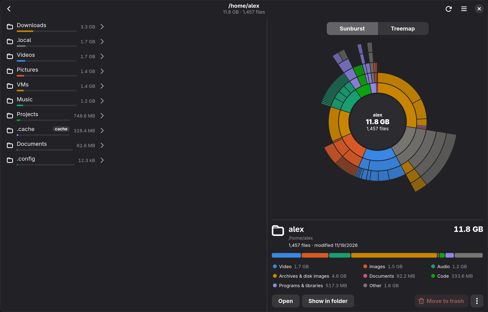
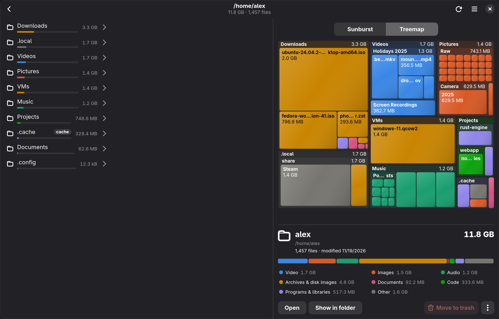
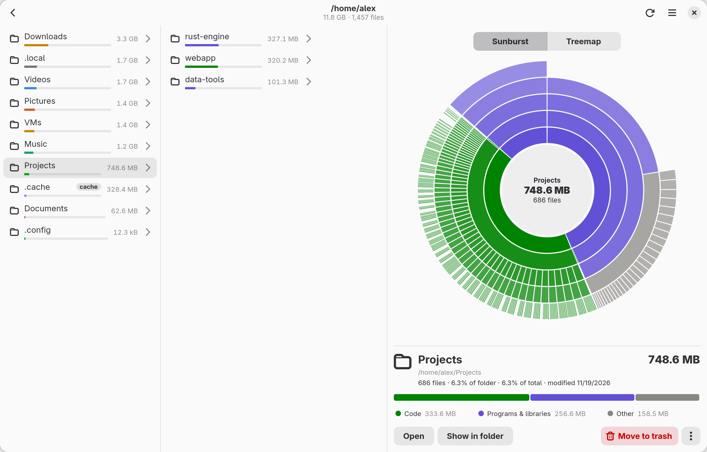
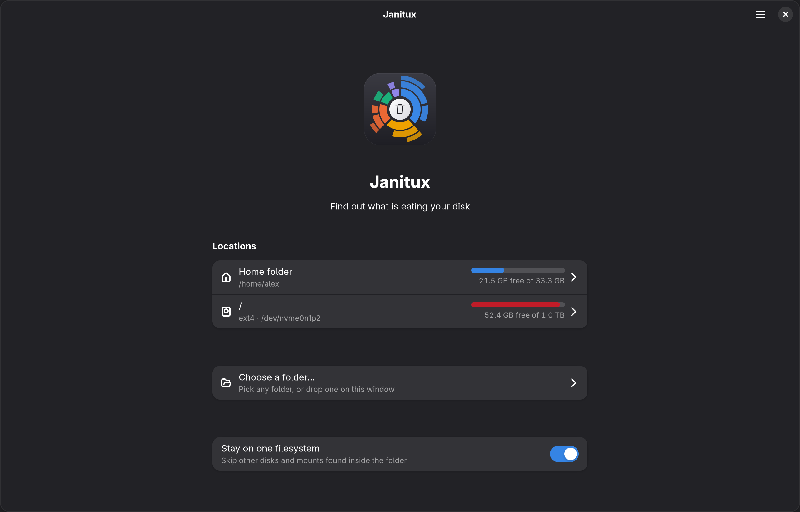

<div align="center">


# Janitux

**Find out what is eating your disk.**

[](https://github.com/RemoGrillo/janitux/actions/workflows/build.yml)
[](https://github.com/RemoGrillo/janitux/releases/latest)
[](LICENSE)
<br>
[](#install)
[](https://gtk.org)
[](https://gnome.pages.gitlab.gnome.org/libadwaita/)
[](https://www.python.org)

</div>

Janitux scans a folder or a whole disk and shows everything in it **sorted by
size, biggest first, at every level**, the way OmniDiskSweeper does on the Mac.
Open a folder and its contents appear in the next column; next to the columns,
an interactive **sunburst** or **treemap** shows where the space goes. When you
find something you don't need, move it to the trash.



## Features

- **Columns sorted by size**: always biggest first, at every depth.
- **Sunburst and treemap** of the selected folder. Hover to highlight, click to zoom in.
- **Colors by content**: video, images, audio, archives, documents, code, programs, with a breakdown for every folder.
- **Safe cleaning**: Delete moves to the trash, Shift+Delete deletes for good (it always asks first).
- **Quick hints**: a `cache` badge marks folders that only hold rebuildable data (`.cache`, `node_modules`, `__pycache__`…).
- **Fast and light**: about 250 000 files a second, sizes identical to `du`, hard links counted once. Dependencies: GTK and nothing else.
- English and Italian.

| Treemap | Light theme |
|---|---|
|  |  |

<details>
<summary>Start page: every disk and how full it is</summary>



</details>

## Install

Grab the file for your system from the [latest release](https://github.com/RemoGrillo/janitux/releases/latest):

| System | Package | Command |
|---|---|---|
| Debian 13+, Ubuntu 24.04+ | `.deb` | `sudo apt install ./janitux_*_all.deb` |
| Fedora 40+ | `.rpm` | `sudo dnf install ./janitux-*.noarch.rpm` |
| Arch Linux | `.pkg.tar.zst` | `sudo pacman -U janitux-*-any.pkg.tar.zst` |
| Any distribution | `.flatpak` | `flatpak install --user janitux-*.flatpak` |
| Any distribution with GTK 4.14+ | `.pyz` (portable, no install) | `chmod +x janitux-*.pyz && ./janitux-*.pyz` |

Or run it straight from the source:

```sh
git clone https://github.com/RemoGrillo/janitux.git && cd janitux
python3 -m janitux            # needs PyGObject, GTK 4.14+, libadwaita 1.5+
```

## Keyboard

| Key | Action |
|---|---|
| ← → ↑ ↓ | move between columns and rows |
| Enter | open a folder / open a file |
| Delete · Shift+Delete | move to trash · delete permanently |
| Backspace | up one level |
| Ctrl+Shift+O · Ctrl+Shift+C | show in file manager · copy path |
| F5 · Ctrl+N | rescan · new scan |

## Build

A plain Makefile, no build system:

```sh
make test          # unit tests
make check         # tests + .desktop and AppStream validation
make pyz           # portable single file
make arch          # Arch package (makepkg)
make deb rpm       # Debian and Fedora packages (nfpm)
make flatpak       # Flatpak bundle (flatpak-builder)
sudo make install  # or PREFIX=/usr, DESTDIR=… for packagers
```

Every push is tested on the oldest supported stack (Ubuntu 24.04: GTK 4.14,
libadwaita 1.5), and every `v*` tag publishes all the packages as a release.

<details>
<summary>How it works</summary>

| File | Role |
|---|---|
| `janitux/scanner.py` | the scan and the size tree (no GUI code, unit tested) |
| `janitux/columns.py` | the column browser |
| `janitux/charts.py` | sunburst and squarified treemap, drawn with GTK snapshots (GPU) |
| `janitux/inspector.py` | side panel: charts, details, breakdown, actions |
| `janitux/window.py` | scanning, selection, trash and delete |
| `janitux/kinds.py` | file kinds and the color palette (checked for color blindness) |
| `janitux/i18n.py` | translations: add a language by adding a dictionary |

Sizes are disk usage (allocated blocks), so they are what deleting frees.
Memory use is about 260 bytes per file.

</details>

## License

[GPL-3.0-or-later](LICENSE) © Remo Grillo
